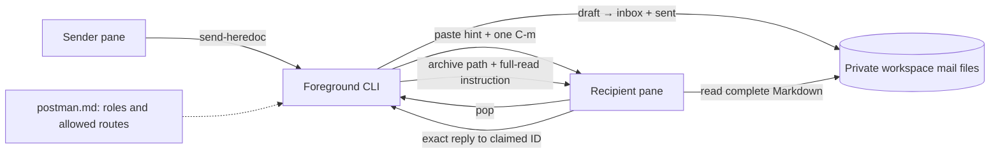
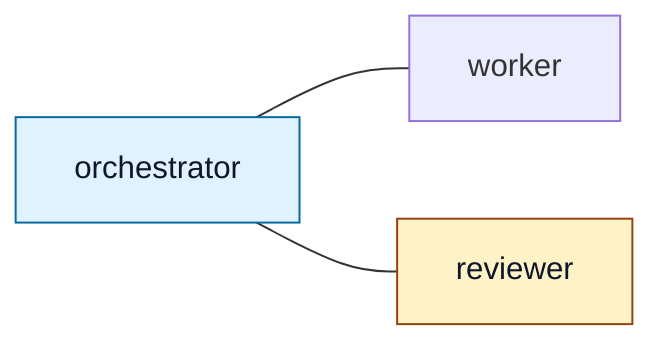

# tmux-a2a-postman

Postman coordinates agents in tmux panes through private workspace mail files.
Each CLI invocation delivers its own mail and attempts an input notification;
no resident Postman process is needed. Codex, Claude Code and local consoles
use the same terminal transport, without model APIs or registration.



Each command runs a finite foreground process. Mail delivery, input
notification, full reading and task completion are separate facts.

## 1. Install and configure

Prerequisites: Linux or macOS and tmux. Execution supports Bash and Zsh;
POSIX-compatible shells can run the same source syntax. Install with Go:

```sh
go install github.com/i9wa4/tmux-a2a-postman@latest
```

Configure `$XDG_CONFIG_HOME/tmux-a2a-postman/postman.md`, or
`$HOME/.config/tmux-a2a-postman/postman.md`. Any operational command accepts
one absolute `--config` override. Relative paths and duplicate options fail.
The default is independent of the current directory.

Illustrative topology:



The rendered graph and the copyable configuration below use the same roles
and edges:

````markdown
## `edges`


## `orchestrator`

Coordinate work and assess evidence.

## `worker`

Implement assigned work and report evidence.

## `reviewer`

Review execution requests.
````

Start each agent in a pane titled with its configured role. The tmux session's
creation directory must be below canonical HOME and is the workspace root;
later `cd` does not redirect mail. Separate worktrees remain independent.
A live independent session cannot also own the same workspace. Verified runtime
replacement preserves mail; unknown ownership does not silently transfer.

`---` declares a bidirectional edge. `interface_node` and an explicit
`workspace_tree` allow direct parent/child interface routes. Numbered
`common_template` and `message_footer` sections remain reserved. Every generated
mail includes recipient-specific common/role instructions, configured ordinary
skill catalogs, `You can talk to` role summaries and exact reply guidance before
the literal sender body. POP explicitly instructs a complete read through EOF.
Topology/status reads do not open catalogs. See the
[configuration reference](skills/postman-config-auditor/references/postman-md.md).

Agent workflows remain separate from CLI help:

```sh
gh skill install i9wa4/tmux-a2a-postman postman-usage --agent codex --scope user
gh skill install i9wa4/tmux-a2a-postman postman-send-message --agent codex --scope user
gh skill install i9wa4/tmux-a2a-postman postman-config-auditor --agent codex --scope user
gh skill install i9wa4/tmux-a2a-postman postman-recall --agent codex --scope user
```

Use `--agent claude-code` for Claude Code. For Codex, setting
`tui.terminal_title = []` preserves role titles. Agents retain responsibility
for their authentication, sandbox and tool permissions.

## 2. Send, receive and inspect

Illustrative syntax:

```sh
tmux-a2a-postman send-heredoc --to worker <<'POSTMAN_BODY'
Implement the change and report the result.
POSTMAN_BODY

tmux-a2a-postman pop
tmux-a2a-postman get-status
```

A node address creates a request requiring a reply. Send stages the complete
body, publishes an independent receiver inbox copy, saves the sender copy,
and attempts a bounded notification. Normal JSON is compact:

```json
{"workspace":"~/work","as_of":"2026-11-01T09:00:00Z","success":true,"self":{"node":"orchestrator","unread_count":0,"inbound_count":0,"outbound_count":1,"draft_count":0,"failed_count":0,"last_pop_at":null,"last_capture_at":null,"last_screen_change_at":null}}
```

`pop` takes no message ID. It claims one own unread message, writes a durable
receipt, and returns an absolute `markdown_absolute_path`; an empty POP returns
null. Read the complete archived Markdown through EOF. Its generated footer
shows the exact reply command. Reply using `send-heredoc --to <POP'd-id>`;
correlation and the return route are automatic. A reply creates no new reply
obligation. Up to 16 different claimed IDs with one sender/return route can
receive one combined reply with comma-separated `--to` IDs.

After restart, compaction or an explicit recall request, use
[postman-recall](skills/postman-recall/SKILL.md) to recover the verified
caller's latest recorded UTC day's read and sent together, then read every
selected archive completely. It uses `created_at`, not mtime or today's date;
recall does not POP, send, edit mail or replace current status with old
narrative.

`get-status` lists all configured nodes in this workspace using the same fields
as `self`. Only the interface caller also sees its declared direct parent and
child interface nodes. Counts come from mailbox files. Unknown values are null.
Reply arrival closes an exact outbound wait before POP. Status reads saved
facts without initialization, POP, capture, notification or deletion.

For the human tmux status bar, `get-status-oneline` gives one line such as
`[0]🟩💛:🟢 [1]⬛🟥` across the explicitly selected native server. Shapes show
unread/inbound work (square), only outbound waits (heart), or zero counts
(circle); unknown counts use `?`. Green/yellow/orange/red show observed
screen-change age, with black for missing or stale captures. This read-only
view needs no agent pane and leaves ordinary `get-status` scope unchanged.
See the [CLI contract](docs/cli-spec.md#31-get-status-oneline) for the palette,
capture freshness and an explicit-socket `#()` invocation.

## 3. Notification and pane observations

Postman pastes a short hint into the existing recipient input and submits one
`C-m`. A destination file lock serializes all Postman writers. Capture checks
that pasted text settled and observes the input area after submission, without
provider names or prompt glyph rules. A doubtful result keeps a pending input
guard; later senders do not paste over it or blindly repeat Enter. Shell prompts
and tmux copy/input modes are rejected before input.

Delivery success and notification are separate. Accepted notifications are
omitted from normal output; an unavailable or uncertain attempt appears in
`notification`. Screen changes do not prove POP, understanding or completion.
Notification failure never removes committed mail. Do not blindly resend after
an uncertain delivery or lost output. Confirmed non-delivery retains complete
`failed` mail; uncertainty preserves draft/recovery evidence.

This controls Postman writers. It does not save/restore unsent human drafts or
exclude unrelated input writers. The former #901 coordinator roadmap was
withdrawn; these limitations remain.

Every valid send and POP, including an empty POP, also saves native pane text
across all windows of its verified session. Shared windows are excluded.
Unconfigured panes keep native identity without fake agent mailboxes. Each
invocation has a 64-pane, 30-line, 8-KiB-per-pane observation limit and a
one-second capture budget, plus bounded persistence. Coverage records identify
partial captures. No mailbox lock is held during screen reads.

All saved logs and captures remain until the user deletes them. There is no
automatic expiry, rotation or cleanup service. Capture clocks describe sampled
native screens; they do not authenticate model continuity or imply work
progress.

## 4. Execute a reviewed command

```sh
tmux-a2a-postman execute-heredoc --reason 'Check for regressions' <<'POSTMAN_COMMAND'
go test ./...
POSTMAN_COMMAND
```

The request records exact source, reason, cwd and tmux's default shell. A fresh
interactive/login shell initializes normal configuration and first-prompt hooks,
including configured project environment loaders. It inherits the caller's
exported environment, without copying a different shell's private live state.
Command stdin is a private PTY with no input forwarding; stdout/stderr stream
separately and are not TTYs. Terminal applications requiring interaction are
outside this command's contract.

A verified present reviewer receives the request. The requesting CLI waits up to
300 seconds and claims only its own exact decision. After POP and full reading,
the reviewer chooses `approve-execution --to <request-id> --reason 'why'` or
`decline-execution --to <request-id> --reason 'why'`. No manual JSON or command
copy is needed. The requester executes, and an active waiter needs no extra TUI
hint for its decision. A duplicate/conflicting choice fails before publication.

An unconfigured or positively absent reviewer permits advisory execution.
Unknown identity, rejection, timeout, interruption or reviewer loss never
converts a waiting request into advisory execution. This coordinates review;
it does not sandbox commands. Child exit codes are forwarded. Final JSON is a
separate last stderr line; uncertain possibly started outcomes have
`executed: null` and must not be automatically repeated. Postman retains minimal
audit records, without automatically saving complete command stdout/stderr.

## 5. Specification and verification

The [CLI specification](docs/cli-spec.md) defines all inputs, outputs, limits
and the keep/simplify/remove inventory. `help`, `help <command>` and each
command's `--help` work without workspace initialization.

```sh
go test ./... -count=1
nix run .#notification-smoke -- --case all
```

The smoke command and Go test share deterministic terminal agents: tmux startup,
real input notifications, receiver-owned POP/full reading/replies, evidence and
owned-fixture cleanup. No real model or account is needed. Optional real Codex
TUI checks use fixed local Responses API decisions through the same terminal
path. See [Contributing](CONTRIBUTING.md) for the test matrix and its limits.

`nix flake check` also validates every shipped skill's deterministic positive
and negative trigger expectations with the pinned offline Waza evaluator.
Run it separately with `nix run .#skill-trigger-check`. These authored heuristic
checks require no model account; manual behavioral suites remain separate.

The [#937 acceptance audit](docs/validation/937-acceptance.md) maps the
implemented core contract to process tests, capture measurements and explicit
remaining integration work.
