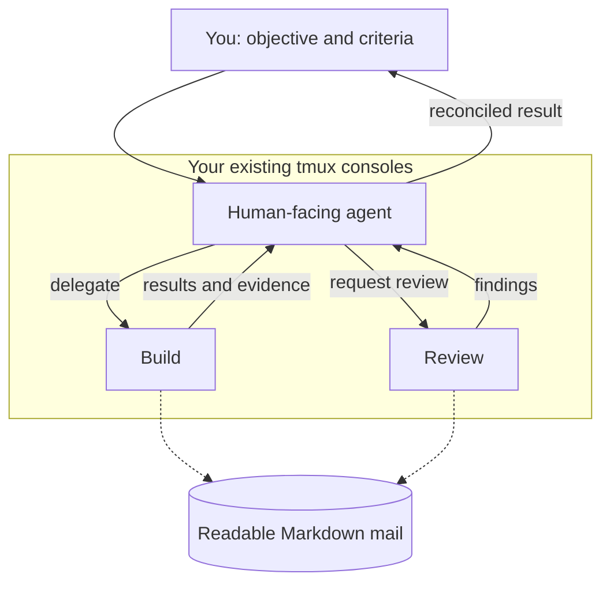
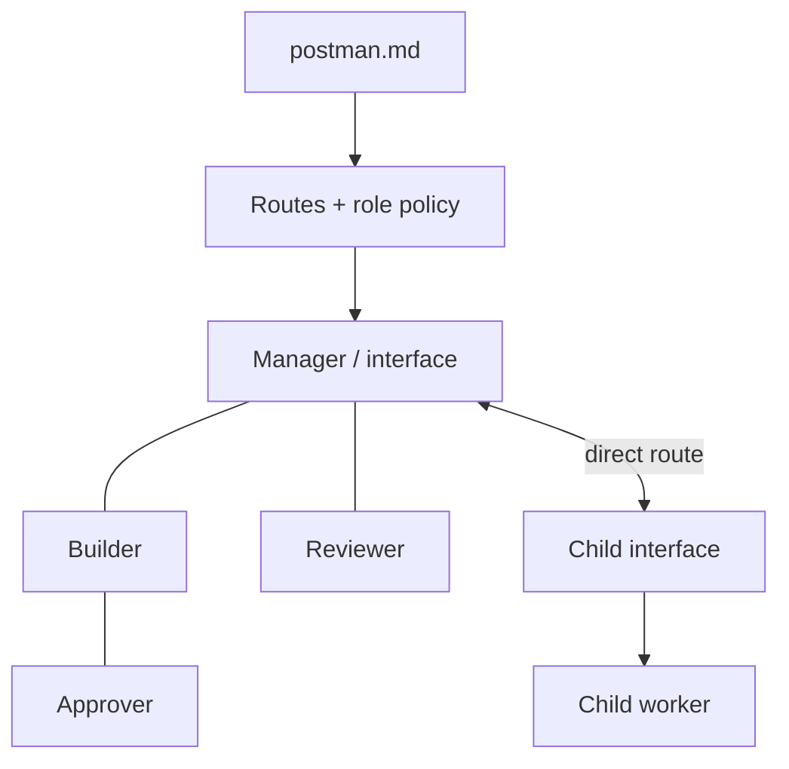
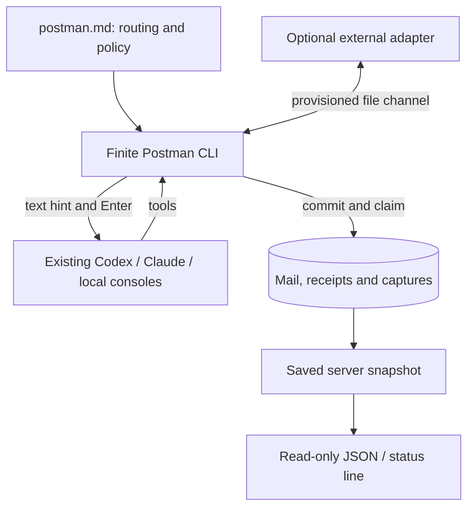
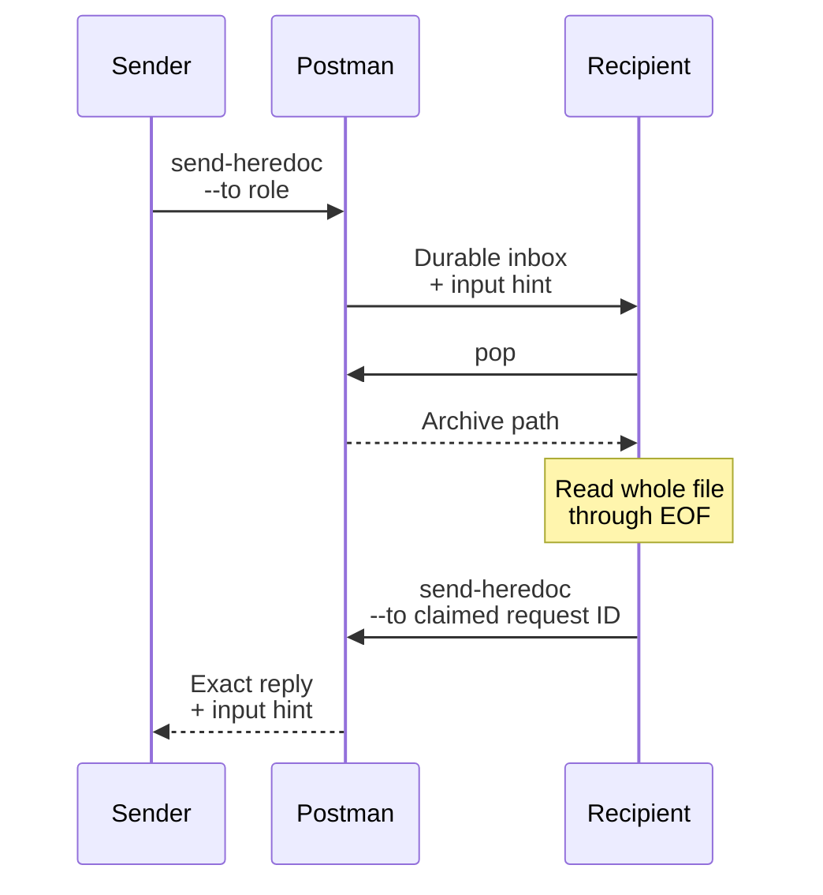

# tmux-a2a-postman

Turn terminal AI consoles into a configurable team, with durable Markdown mail
and no required resident Postman service. An optional foreground `daemon`
wrapper can invoke fresh heartbeat CLI processes on a selected interval.



Keep your clients, models and tool permissions. Postman supplies explicit
routes, durable delivery, input notifications and correlated replies. Delivery
does not prove task completion; agents reconcile results against your objective.

## 1. Configure the organization



Use the embedded standard team without a configuration file, or customize
the whole organization in one file. Artifact review and command approval are
different roles; review coordinates decisions and is not an OS sandbox.
Direct parent/child routes use live interface panes in distinct nested
workspaces. The nearest live interface blocks shortcuts to more distant teams.
The configuration reference defines the supported fields.

## 2. Small commands, durable files



Transport uses native tmux panes and ordinary files, without model APIs.
Optional [`launch-agents`](help/launching.md) creates one declared team and
exits, without startup prompt injection or supervision. External services own
their adapter and activation; no native GitHub/mobile service is implied.



Messages carry the recipient's instructions and contacts. Requests carry an
exact reply command; replies guide a fresh named request if more work is needed.
Notification uncertainty leaves committed mail intact. Logs remain until you
delete them.

## 3. Install and try

Requires Go (the version specified in [go.mod](go.mod)), tmux and an agent
console able to run shell tools. Install from `main` to match these docs:

```sh
go install github.com/i9wa4/tmux-a2a-postman@main
```

Add Go's install directory (`GOBIN`, or `GOPATH/bin` when `GOBIN` is unset) to
your consoles' `PATH`, then check the installed version:

```sh
tmux-a2a-postman version
```

Client installation, authentication and sandbox settings remain yours.

The binary includes complete CLI help and six complete portable Skills. Read
`tmux-a2a-postman help setup` for setup, `tmux-a2a-postman skill <name>` for a
full Skill, and `tmux-a2a-postman skill <name> <ref>` for a Markdown reference.
These reads need no checkout, tmux, configuration, or extraction. Tracked
`dist/skills/` contains thin discovery entries for client installation alongside
the same-revision binary; [Skill help](help/skills.md) explains this layout.

Start with the [builtin standard team](config/postman.md) and
`tmux-a2a-postman skill postman-send-message`; no dotfiles or Skill installation
is required. That same default `postman.md` contains all startup presets:

| Preset     | Consoles and layout                                                   |
| ---------- | --------------------------------------------------------------------- |
| `dev`      | Two equal columns: focused `editor` shell and one `agent` role        |
| `preset-p` | Existing vde-layout Codex team: two columns, seven roles              |
| `preset-w` | Existing vde-layout mixed Codex/Claude team: two columns, seven roles |

The `dev` preset runs no editor command; its agent uses the original explicit
Codex command. The two seven-role presets retain their original model, effort
and permission arguments. Preview the exact commands before choosing a preset:

```sh
tmux-a2a-postman launch-agents --list
tmux-a2a-postman launch-agents dev --dry-run
tmux-a2a-postman launch-agents preset-p --dry-run
```

Remove `--dry-run` to launch. From an existing tmux pane, the team opens in a
new window of that session. `--session` or `--socket` selects dedicated-session
behavior. Existing consoles can instead start with a send.
Inspect the builtin `postman.md` with
`tmux-a2a-postman help config default`.
Read `help config` to export a custom copy and select it.

Follow the [first exchange](help/quickstart.md) and
the [configuration reference](help/postman-md.md) to choose roles and routes.

The repository mirrors the installed interface:

```text
help/*.md                 CLI usage, configuration and communication specs
skills/<name>/SKILL.md   complete canonical Skill source
skills/<name>/references/ and scripts/  required portable dependencies
dist/skills/<name>/SKILL.md  generated, tracked discovery entry
config/                  bundled configuration assets
docs/                    design, research, development and validation
testdata/                test-only fixtures
```

## 4. Guides and references

- [Quickstart and operations](help/quickstart.md):
  setup, mail, observations and troubleshooting.
- [Configuration reference](help/postman-md.md):
  anatomy, examples and exact supported fields.
- [CLI contract](help/cli-spec.md) and `tmux-a2a-postman help`: command inputs
  and outputs.
- [Command review](help/execution.md),
  [server status](help/server-status.md), and
  [external file integration](help/external-filesystem-channel.md).
- [Canonical Skills](skills/) and [tracked distribution](dist/skills/):
  six complete embedded workflows and matching thin discovery entries.
- [Skill use](help/skills.md),
  [records](skills/postman-records/references/records.md), and
  [review](skills/subagent-review/references/report.md): current binary reading
  and portable procedures.
- [Historical migration inventory](docs/design/standard-team-migration.md):
  source decisions and verification boundaries before the six-Skill layout.
- [Contributing](docs/development/contributing.md): development, deterministic
  tmux tests and evidence limits.

This repository's [AGENTS.md](AGENTS.md) guides contributors. Your runtime
`postman.md` configures your team; it is a separate instruction surface.
