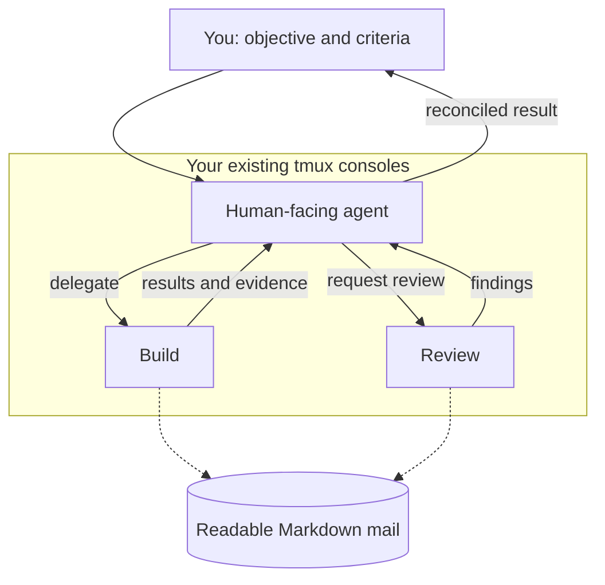
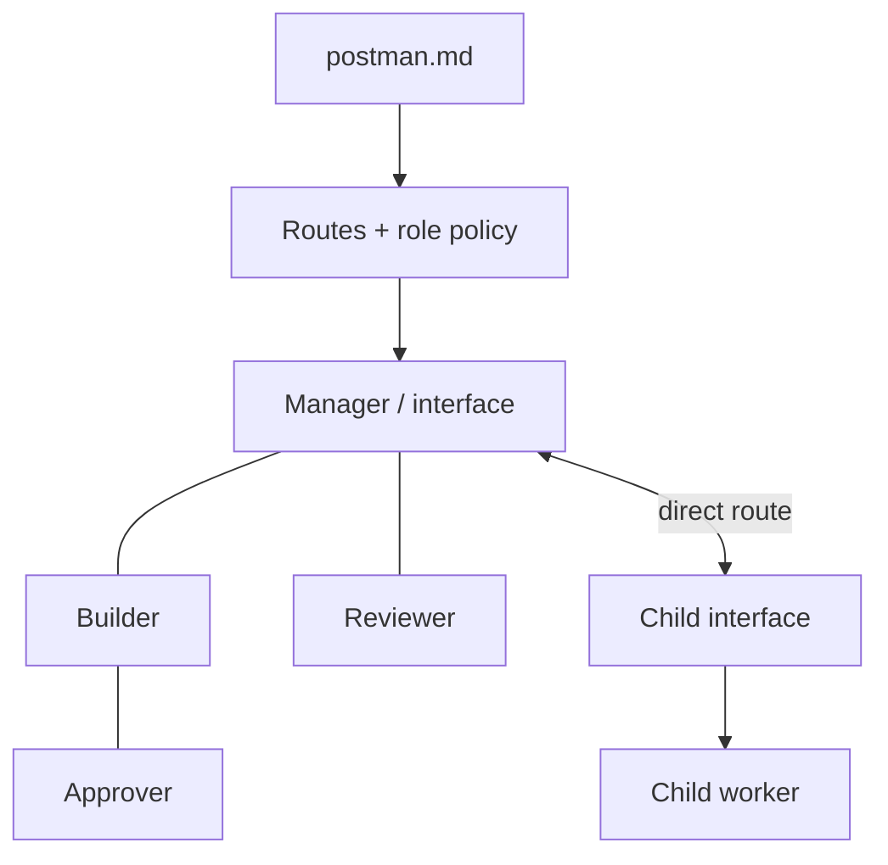
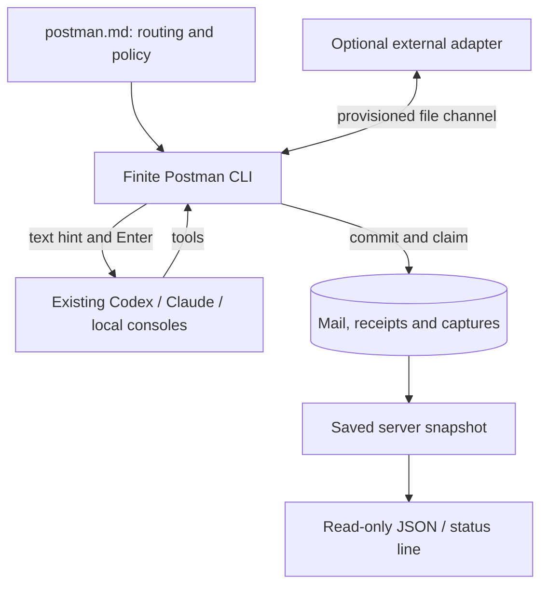
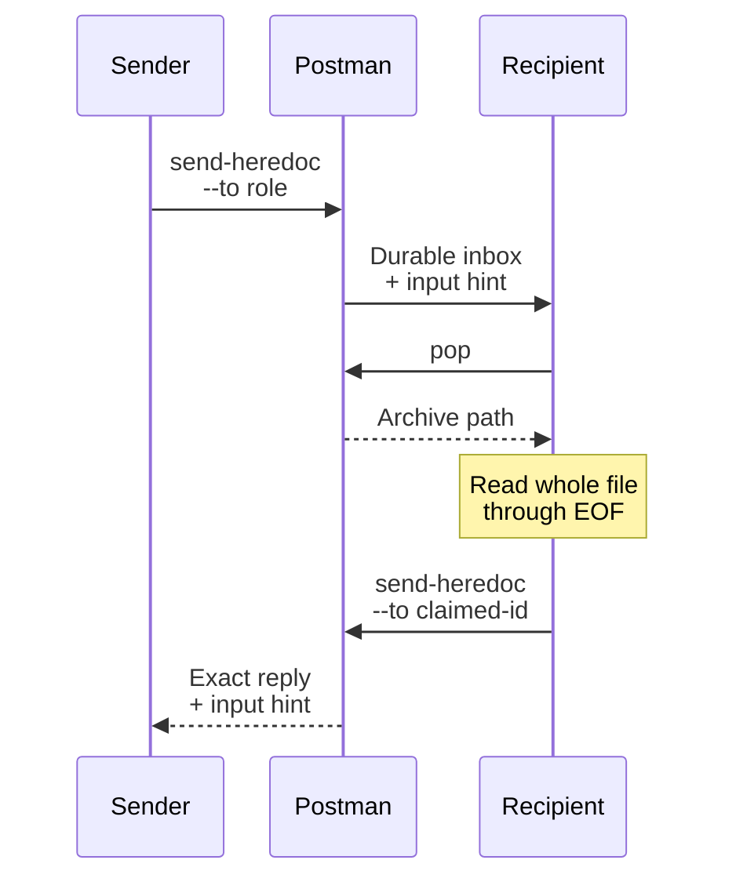

# tmux-a2a-postman

Turn terminal AI consoles into a configurable team, with durable Markdown mail
and no resident Postman service.



Keep your clients, models and tool permissions. Postman supplies explicit
routes, durable delivery, input notifications and correlated replies. Delivery
does not prove task completion; agents reconcile results against your objective.

## 1. Configure the organization



Choose the organization in one file. Artifact review and command approval are
different roles; review coordinates decisions and is not an OS sandbox.
Direct parent/child routes require declared interfaces and distinct workspaces.
The diagrams here explain capabilities; copy the tested configurations below.

## 2. Small commands, durable files



Transport uses native tmux panes and ordinary files, without model APIs.
Optional [`launch-agents`](docs/launch-agents.md) creates one declared team and
exits, without startup prompt injection or supervision. External services own
their adapter and activation; no native GitHub/mobile service is implied.



Messages carry the recipient's instructions, contacts and exact reply command.
Notification uncertainty leaves committed mail intact. Logs remain until you
delete them.

## 3. Install and try

Requires tmux and an agent console able to run shell tools. These docs describe
this checkout; older release tags may expose a different CLI. Build the same
source you are reading:

```sh
git clone https://github.com/i9wa4/tmux-a2a-postman.git
cd tmux-a2a-postman
nix build
./result/bin/tmux-a2a-postman version
```

Without Nix, use the Go version selected in `go.mod` and `go install .`.
Put the resulting binary on your consoles' `PATH`. Client installation,
authentication and sandbox settings remain yours.

The binary includes complete Markdown guidance: run
`tmux-a2a-postman help setup` or `tmux-a2a-postman help <topic>` without a
checkout, tmux or configuration. Thin Skills discover these installed topics;
`tmux-a2a-postman help skills` explains the thin entries and consumer-owned
setup. Updating the binary updates the detailed procedures.

Follow the [first exchange](docs/quickstart.md) with the complete
[minimal config](examples/minimal/postman.md). Then try the
[practical team](examples/practical/postman.md),
[parent/child team](examples/hierarchy/postman.md), or
[optional launch presets](examples/launch/postman.md).

## 4. Guides and references

- [Quickstart and operations](docs/quickstart.md): setup, mail, observations and
  troubleshooting.
- [Configuration reference](internal/helpdocs/topics/postman-md.md):
  anatomy, examples and exact supported fields.
- [CLI contract](docs/cli-spec.md) and `tmux-a2a-postman help`: command inputs
  and outputs.
- [Command review](docs/command-approvals.md),
  [server status](docs/design/server-status.md), and
  [external file integration](docs/design/external-filesystem-channel.md).
- [Installable Skills](skills/): usage, sending, recall, configuration audit and
  team management.
- [Contributing](CONTRIBUTING.md): development, deterministic tmux tests and
  evidence limits.

This repository's [AGENTS.md](AGENTS.md) guides contributors. Your runtime
`postman.md` configures your team; it is a separate instruction surface.
