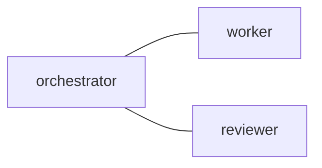

# tmux-a2a-postman

`tmux-a2a-postman` coordinates local AI coding agents in tmux panes through
private workspace mail files and foreground commands. No resident Postman
process is needed.

Any AI coding agent that can run commands in a tmux pane can use the same
`send-heredoc`, `pop`, `get-status`, and `execute-bash` commands. These four
commands derive workspace identity from the native tmux server, session and
pane, then use a configured `postman.md` for roles and Mermaid edges. They do
not require a running Postman daemon.

## 1. Install and configure

Prerequisites are macOS or Linux, Go, and tmux. Install the binary with:

```sh
go install github.com/i9wa4/tmux-a2a-postman@latest
```

For the development branch, create
`$XDG_CONFIG_HOME/tmux-a2a-postman/postman.md`, or use
`~/.config/tmux-a2a-postman/postman.md` when XDG_CONFIG_HOME is unset.
Each of the four commands also accepts an absolute `--config` or
`--postman-md` path. The default and overrides are independent of the
caller's current directory. A missing, unreadable, or ambiguous topology
fails closed.

This is illustrative configuration syntax, not runtime output:

````markdown
## `edges`



## `orchestrator`

Coordinate work and accept evidence.

## `worker`

Implement assigned work and report evidence.

## `reviewer`

Review command requests and reply with an exact decision.
````

Run each role in a tmux pane with its role as the pane title. The parser
accepts a strict Mermaid subset: `---` declares an edge. Only configured
adjacent nodes can exchange mail. Other topology sections can hold role
instructions. `interface_node` is optional; marking a reviewer with
`command_approver_node` enables blocking command approval.

Packaged Codex or Claude Code skills can be installed with `gh skill install`
for agent instructions:

```sh
gh skill install i9wa4/tmux-a2a-postman postman-usage --agent codex --scope user
gh skill install i9wa4/tmux-a2a-postman postman-send-message --agent codex --scope user
gh skill install i9wa4/tmux-a2a-postman postman-config-auditor --agent codex --scope user
```

Use `--agent claude-code` for Claude Code. The skills explain safe sending,
mailbox operation, and configuration auditing respectively.

Start the agents in tmux panes titled with their configured roles. The same
notification transport serves Codex, Claude Code and local LLM consoles: after
mail commits, Postman pastes a short notification into the recipient's existing
input field and submits it with `C-m`. The recipient then POPs the exact mail,
reads its full archive, and replies through ordinary Postman commands.

This preserves the original pane-notification workflow. No model-specific API,
thread ID, recipient registration, shell hook, or resident Postman process is
required. The named tmux buffer, paste, short input-processing delay, and submit
run in one bounded foreground command list. Independent sends to one recipient
are serialized so their notification text cannot mix.

Agents must accept terminal text and `C-m` and retain their configured role
pane titles. Configure title updates in the agent if needed; for Codex,
`tui.terminal_title = []` preserves vde-layout's role titles. The agent's own
sandbox, tool permissions and model authentication remain its responsibility.
An ordinary shell prompt or tmux copy mode reports notification unavailable
while leaving the committed mail intact. Start the role's agent console first.

As with the original pane input, notification text enters the current composer.
Postman does not save/restore human drafts or claim exclusive control of an
agent's input editor. Use the role panes for the agent's automated mail flow.

Verify the complete transport without AI models, API accounts or Codex:

```sh
nix run .#notification-smoke -- --case all
```

Deterministic terminal agents receive the actual pasted text and submit key,
then POP, read through EOF, and reply. Sixteen cases cover plain line input and
bracketed-paste input, including rallies, busy receivers, concurrent messages,
parent/child routes, approval/rejection, and blocked notification controls.
An additional test uses the real Codex TUI with fixed local model responses
through this **same tmux input path**. See [Contributing](CONTRIBUTING.md).

The commands use only Markdown topology and the XDG state root. Old Postman
daemon commands, daemon RPC, Postman TOML configuration, and legacy root/lock
gates are removed. The first send, POP, or execution
creates private state directories as needed. Initial `get-status` is read-only
and reports unknown if state is missing; it does not require startup or
initialization.

## 2. Send and receive

These commands are illustrative syntax, not a recorded run:

```sh
tmux-a2a-postman send-heredoc --to worker --reply-required <<'POSTMAN_BODY'
Implement the change and report the result.
POSTMAN_BODY

tmux-a2a-postman pop
tmux-a2a-postman get-status
```

`send-heredoc` reads literal quoted-heredoc stdin, verifies the local edge, then
synchronously publishes separate private receiver-inbox and sender-sent copies.
Its JSON includes the committed `message`, file-derived `self` state, and a
separate `notice` result. The notification path uses the common
tmux input transport. `notice.status=accepted` means tmux accepted the
notification paste and submit key; only POP receipts prove claims, and exact
replies prove responses. Unavailable or blocked input produces
`notice.status=unavailable`; transport ambiguity produces `unknown`.
Notification failure never reverses committed mail. Sending waits only for
bounded delivery and notification work, never for POP, a reply, or completion.
Neither mail nor a notice should be blindly resent after an uncertain result.

`pop` atomically claims one own unread message and returns an openable
`markdown_absolute_path` plus its `pop_receipt_absolute_path`. The body is
not embedded in JSON. Read the complete archived Markdown through EOF before
handling the message. A successful claim is not repeated; an empty POP still
returns `self` state. An optional exact message ID selects only that
eligible own message.

Replies use the exact `--reply-to <message-id>` and
`--fills-input-request-id <input-request-id>` from the original required
message. `--reply-required` opens an obligation; `--no-reply` does not.
Filling an input request closes transport, not task acceptance. A completion
report should carry `Task artifact:`, `Original checklist: PASS`,
`Evidence:`, and `Remaining blockers: none`. Use `BLOCKED` with
`Original checklist: FAIL` while requirements remain. Receivers verify
the checklist status, durable references, evidence, and blockers before
relaying, approving, or closing work.

The `self` object reports known/unknown state, workspace and role, unread
count, exact inbound/outbound obligations, verified local peers, next action,
and observation time. `get-status` reads this saved-file state without
claiming mail or capturing panes. Missing or damaged evidence is unknown,
not zero work.

## 3. Execute a reviewed command

This command is illustrative syntax, not a recorded run:

```sh
tmux-a2a-postman execute-bash --command 'go test ./...'
```

A configured, live `command_approver_node` receives an exact
reply-required request. The requester waits up to 300 seconds for a matching
reply from that reviewer. Its body is JSON with `version: 1`, the exact
`command`, and `decision` set to `approved` or `rejected`; the reply must
also fill the request's exact input ID. Unrelated inbox mail is left alone.
Only verified reviewer absence permits advisory execution. Ambiguous
configuration or a lost reviewer fails closed. Bash runs outside the mailbox
lock; command stdout/stderr stream normally, and Postman writes result JSON
to stderr. A nonzero Bash exit is reported as `exited`. The wrapper coordinates
review and audit; it does not sandbox Bash.

After the approval request commits, `execution.notice` separately reports
the notification outcome through the same tmux input route. The existing
reviewer receives the hint, reads the full request and sends the exact decision.
A notification failure never grants approval or creates another request. The
waiting foreground wrapper claims its own exact decision, so the blocked
requester model does not have to run POP.

## 4. Optional pane evidence

`send-heredoc` and `pop` accept `--capture-related-panes`. Native pane-text
capture currently fails closed with explicit unknown evidence and no text:
mutable tmux titles cannot prove continuous role attribution during a read.
Positive native capture and its trust boundary remain open in issue #937.
Capture failure is supplemental and never reverses committed mail.

The active command help is `tmux-a2a-postman help send-heredoc`,
`help pop`, `help get-status`, and `help execute-bash`. See
[postman.md syntax](skills/postman-config-auditor/references/postman-md.md)
and
[agent runtime feature differences](docs/agent-runtime-feature-differences.md)
for further context. Claude Code and Codex CLI have different runtime surfaces
outside postman.
