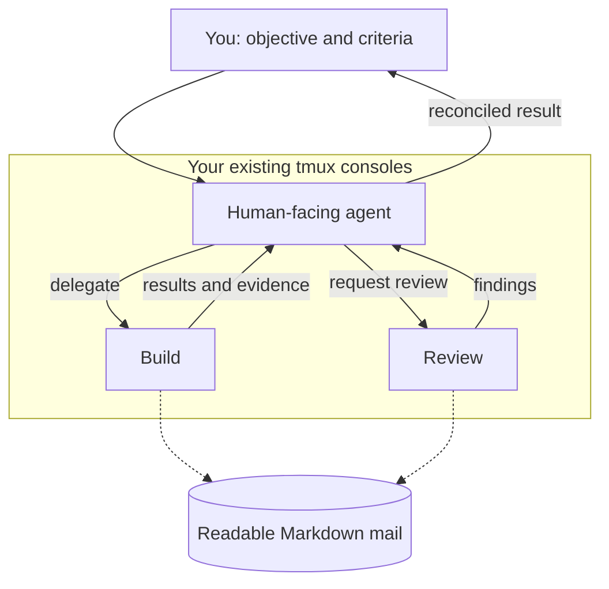
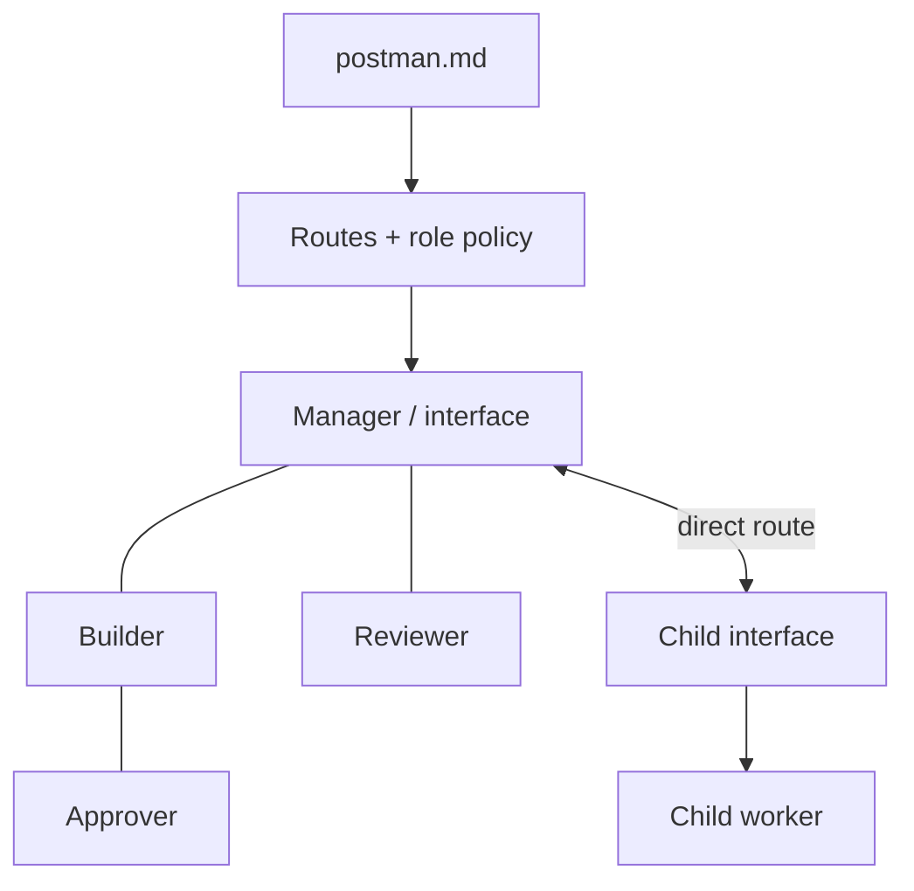
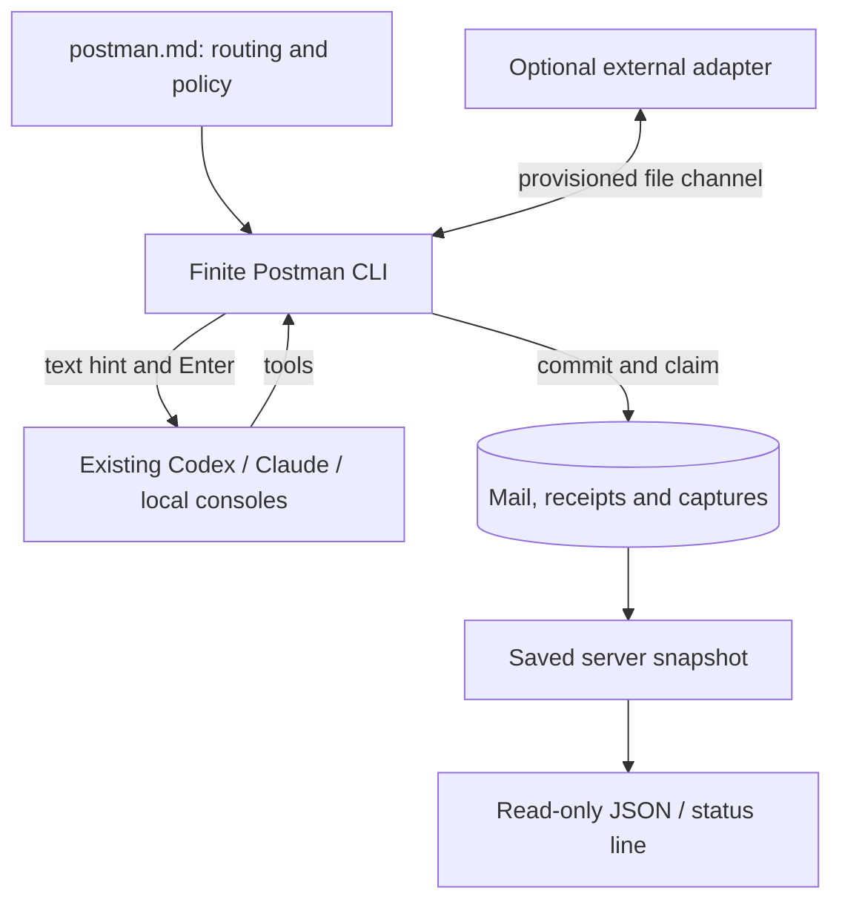
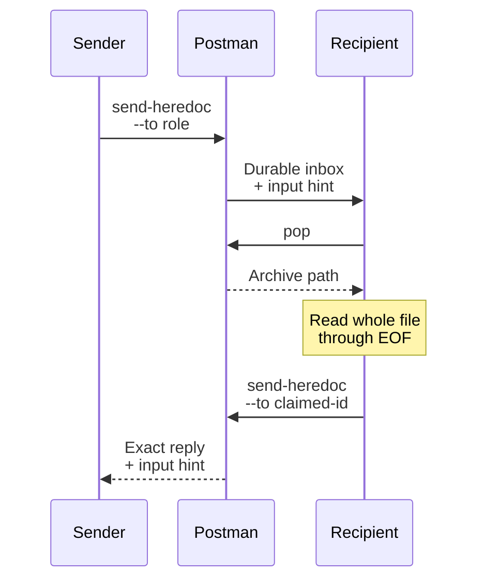

# tmux-a2a-postman

Turn terminal AI consoles into a configurable team, with durable Markdown mail
and no resident Postman service.



Keep your clients, models and tool permissions. Postman supplies explicit
routes, durable delivery, input notifications and correlated replies. Delivery
does not prove task completion; agents reconcile results against your objective.

## 1. Configure the organization



Use the embedded standard team without a configuration file, or customize
the whole organization in one file. Artifact review and command approval are
different roles; review coordinates decisions and is not an OS sandbox.
Direct parent/child routes require declared interfaces and distinct workspaces.
The configuration reference defines the supported fields.

## 2. Small commands, durable files



Transport uses native tmux panes and ordinary files, without model APIs.
Optional [`launch-agents`](help/launching.md) creates one declared team and
exits, without startup prompt injection or supervision. External services own
their adapter and activation; no native GitHub/mobile service is implied.



Messages carry the recipient's instructions, contacts and exact reply command.
Notification uncertainty leaves committed mail intact. Logs remain until you
delete them.

## 3. Install and try

Requires Go (the version specified in [go.mod](go.mod)), tmux and an agent
console able to run shell tools. Install from `main` to match these docs:

```sh
go install github.com/i9wa4/tmux-a2a-postman@main
```

Add Go's install directory (`GOBIN`, or `GOPATH/bin` when `GOBIN` is unset) to
your consoles' `PATH`, then check the installed version:

```sh
tmux-a2a-postman version
```

Client installation, authentication and sandbox settings remain yours.

The binary includes complete Markdown guidance: run
`tmux-a2a-postman help setup` or `tmux-a2a-postman help <topic>` without a
checkout, tmux or configuration. Thin Skills discover installed workflow
references; `tmux-a2a-postman help skills` explains the thin entries and
consumer-owned setup. Updating the binary updates the detailed procedures.

Install a thin Skill with GitHub CLI:

```sh
gh skill install i9wa4/tmux-a2a-postman postman-usage --agent codex --scope user
```

Use `--agent claude-code` for Claude Code. Replace `postman-usage` with any
workflow name listed by `tmux-a2a-postman help` to install another entry.
Read the full procedure with `tmux-a2a-postman help <name>`, then matching
references with `tmux-a2a-postman help <name> <ref>`.

Start with the [builtin standard team](config/postman.md) and
`tmux-a2a-postman help postman-orchestrate`; no dotfiles or Skill installation
is required. That same default `postman.md` contains all startup presets:

| Preset     | Consoles and layout                                                   |
| ---------- | --------------------------------------------------------------------- |
| `dev`      | Two equal columns: focused `editor` shell and one `agent` role        |
| `preset-p` | Existing vde-layout Codex team: two columns, seven roles              |
| `preset-w` | Existing vde-layout mixed Codex/Claude team: two columns, seven roles |

The `dev` preset runs no editor command; its agent uses the original explicit
Codex command. The two seven-role presets retain their original model, effort
and permission arguments. Preview the exact commands before choosing a preset:

```sh
tmux-a2a-postman launch-agents --list
tmux-a2a-postman launch-agents dev --dry-run
tmux-a2a-postman launch-agents preset-p --dry-run
```

Remove `--dry-run` to launch. From an existing tmux pane, the team opens in a
new window of that session. `--session` or `--socket` selects dedicated-session
behavior. Existing consoles can instead start with a send.
Inspect the builtin `postman.md` with
`tmux-a2a-postman help config default`.
Read `help config` to export a custom copy and select it.

Follow the [first exchange](help/postman-usage/references/quickstart.md) and
the [configuration reference](help/postman-md.md) to choose roles and routes.

The repository mirrors the installed interface:

```text
help/                 CLI usage: help <topic>
  <name>/SKILL.md      canonical workflow: help <name>
  <name>/references/   detailed procedures: help <name> <ref>
  <name>/scripts/      optional helpers
  <name>/evals/        workflow evaluation fixtures
skills/<name>/
  SKILL.md            generated header + one-line help instruction
config/               bundled configuration assets
docs/                design, research, development and validation
testdata/            test-only fixtures
```

## 4. Guides and references

- [Quickstart and operations](help/postman-usage/references/quickstart.md):
  setup, mail, observations and troubleshooting.
- [Configuration reference](help/postman-md.md):
  anatomy, examples and exact supported fields.
- [CLI contract](help/cli-spec.md) and `tmux-a2a-postman help`: command inputs
  and outputs.
- [Command review](help/execution.md),
  [server status](help/server-status.md), and
  [external file integration](help/external-filesystem-channel.md).
- [Installable Skills](skills/): usage, sending, recall, configuration audit and
  team management, planning, records, orchestration and review.
- [Operating procedures](help/postman-orchestrate/references/intake.md),
  [planning](help/postman-plan/references/investigation.md),
  [records](help/postman-records/references/selection.md), and
  [review](help/postman-review/references/routing.md): the canonical Skill
  references available in the binary.
- [Migration inventory](docs/design/standard-team-migration.md): source
  ownership, portability and verification boundaries.
- [Contributing](docs/development/contributing.md): development, deterministic
  tmux tests and evidence limits.

This repository's [AGENTS.md](AGENTS.md) guides contributors. Your runtime
`postman.md` configures your team; it is a separate instruction surface.
