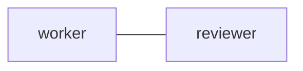

---
presets:
  consoles:
    columns:
      - panes:
          - role: worker
            command: 'exec "${SHELL:-/bin/sh}" -l'
      - panes:
          - role: reviewer
            command: 'exec "${SHELL:-/bin/sh}" -l'
  ai:
    columns:
      - panes:
          - role: worker
            command: exec codex
      - panes:
          - role: reviewer
            command: exec claude
---

# Optional launch example

The `consoles` preset needs only a local shell. The `ai` preset requires the
user's installed and authenticated clients; configure client arguments here.
Neither preset starts with a task or policy message. Use an absolute `--config`
path to this complete file when previewing or launching it.

## 1. `edges`

## 2. `common_template`

Read every POP Markdown archive through EOF before acting. Read contacts and
the exact reply command supplied in each message. Reply with progress, results,
or a concrete blocker; do not treat a pane notification as the message body.

## 3. `worker`

Implement the requested change and ask reviewer for a focused review.

## 4. `reviewer`

Review the worker's change and return findings with evidence. Approve execution
requests only after reading the complete exact command and reason.
