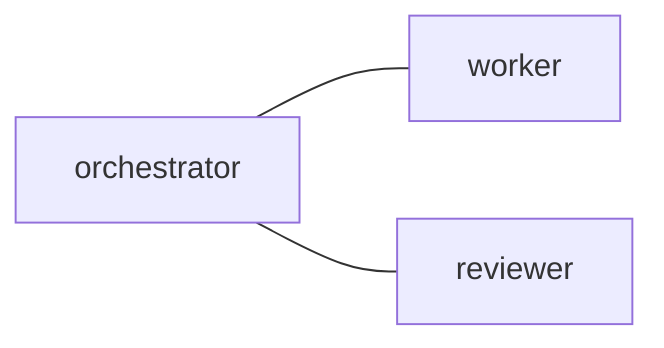

# Configuration Source of Truth

This is the issue #937 target for the four file-first commands. The
daemon-free cutover is still under review. The supported command
configuration is `postman.md` plus explicit CLI overrides, not a running
daemon's startup snapshot.

## 1. Topology and identity

The `edges` Mermaid graph declares in-session peers and optional
`interface_node` and `command_approver_node` classes. Only adjacent
roles may exchange ordinary mail. Frontmatter `workspace_tree` declares
direct parent and child interface relationships across independent
sessions; it is an authorization input, not a live-owner registry.
Current native tmux binding proves which server, session, pane, and role
may act as the caller. Saved workspace identity remains stable after
the caller changes directory.

A minimal target topology is:

The command approver class must name a real configured node. A
configured but unverified approver is not positively absent. The
approval contract belongs in [command approvals](../command-approvals.md).

## 2. Loading and skill catalogs

Each invocation reads its configured `postman.md`; an explicit absolute
`--config` or `--postman-md` overrides the XDG default. Missing,
unreadable, or ambiguous topology fails closed. The four commands do
not merge legacy `postman.toml`, split node files, daemon PING
settings, or cwd-local overlays.

A normal `skill_path` selects agent-facing `SKILL.md` metadata for
the role catalog. The send, mailbox, and config-audit skills have
distinct responsibilities. A skill catalog is instructions for an
agent, not a background message source. There is no startup PING
requirement for the four file-first commands.

## 3. Cutover

Legacy daemon configuration and its startup snapshot remain relevant
only to an old runtime that has not yet been retired. Do not run old
and new writers against the same active state. A verified transition
must migrate or archive old mail without converting old approval
history into new authorization. The [architecture](file-first-architecture.md)
defines workspace ownership and transition safety.
