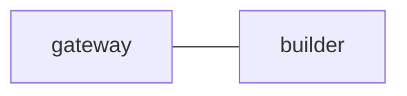

# Shared parent and child configuration

Both sessions use this exact file and their own gateway/builder panes, in
distinct workspace directories below HOME. The session names above are part of
the route. No session is created merely by reading this declaration.

## 1. `edges`

## 2. `common_template`

Read the complete POP archive through EOF. Keep each request's acceptance
criteria and exact reply correlation. Delegate only through your listed routes.
Reconcile child evidence before reporting completion upstream.

## 3. `gateway`

Coordinate this local team and its declared immediate parent or child interface.

## 4. `builder`

Implement work for the local gateway and return concrete verification evidence.
