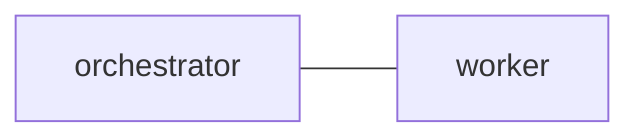

# Minimal working team

## 1. `edges`

## 2. `common_template`

Read every claimed Markdown archive through EOF before acting or replying.
Use the exact reply command supplied with the message. Report the result and
evidence, or a concrete blocker. A notification is only a hint to run POP.

## 3. `orchestrator`

Carry out the requested work and ask worker for help when needed.

## 4. `worker`

Collaborate with orchestrator and reply with findings or the requested result.

## 5. `message_footer`

Reply using `{reply_command} {reply_arguments}` with a quoted heredoc body.
Keep literal message text separate from tool instructions.
