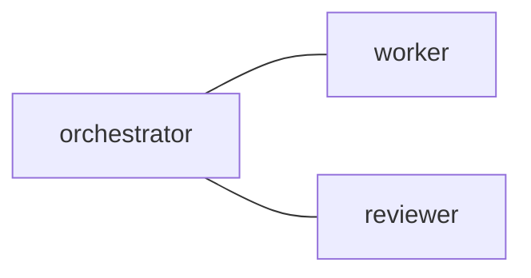

# config — file-first workspace topology

The active workspace commands read one
postman.md. Default path:

```sh
$XDG_CONFIG_HOME/tmux-a2a-postman/postman.md
~/.config/tmux-a2a-postman/postman.md when XDG_CONFIG_HOME is unset
```

Operational commands accept one absolute --config override. Otherwise the
documented inherited TMUX_A2A_POSTMAN_CONFIG selection takes precedence over
the XDG/HOME default. launch-agents sets it only for its newly created session.
The two cache-only status getters ignore config selection.
Relative paths and a relative XDG_CONFIG_HOME fail closed. Configuration is
reread by each invocation; no daemon restart is needed for these commands.

The file-first reader uses a bounded regular Markdown file and a strict
Mermaid subset in the `edges` section. `---` declares a bidirectional local
edge. Role headings with backtick names and nodes in the graph define roles.
One `command_approver_node` class may select an execution reviewer;
`interface_node` marks an interface role. Missing or ambiguous configuration
does not authorize mail or command execution.

Example syntax (not a recorded run):

````markdown
## `edges`


````

Only this Markdown topology configures the commands. TOML overlays, daemon
policy settings, startup and daemon RPC are removed. State uses the absolute
XDG_STATE_HOME or HOME/.local/state. Receiving agents need no notifier
registration.

Optional external filesystem binding (frontmatter scalar strings):

```sh
external_mailbox_root: /absolute/canonical/private/mailbox
external_workspace: ~/canonical/session-root
external_session: exact-native-session-name
```

It also requires interface_node and the declared top-level interface. Distinct
bindings use separate private roots. See help channel-sync and
`tmux-a2a-postman help external-filesystem-channel` for producer activation and
recovery.

Optional YAML presets define ordered columns of panes with role/command pairs.
Only explicit launch-agents executes those commands; --list and --dry-run are
inert. See help launch-agents and `tmux-a2a-postman help launching`.

## 1. Builtin standard team and complete overrides

When the automatic XDG/HOME path has no directory entry, the binary uses its
embedded standard team. An explicit --config or nonempty inherited
TMUX_A2A_POSTMAN_CONFIG always selects that complete file. Empty --config is an
error; empty inherited selection keeps automatic discovery. A custom file
replaces all default roles, routes, policy and catalogs. No implicit merge.
An unreadable, malformed, non-regular or dangling-symlink default is an error,
not absence. Nix-managed valid symlinks remain supported.

No default file is copied to the configuration directory. Binary upgrades
therefore update builtin policy and HelpDocs together. Archives preserve their
original rendered bytes/digest; upgrades never rerender old mail. Generated
archives identify authored policy SHA256 and, for builtin policy, bundle ID.
Cached scope records identify the selected file/default and fingerprint; they
use the original registered source even if a status collector has another HOME.
A selected default appearing as a file during delayed approval is a source
change, never permission to switch or execute.

Inspect the exact installed default without selecting or modifying it:

```sh
tmux-a2a-postman help config default
```

To customize, explicitly copy that complete file to a new chosen path with
noclobber semantics, inspect/edit it, then select the absolute path. For
example:

```sh
(set -C; tmux-a2a-postman help config default > /absolute/new-postman.md)
```

This example refuses an existing destination. No command overwrites a user's
configuration automatically. `resources` materializes only its
content-identified cache bundle. Its default, licenses, optional record helper
and review prompts are portable and require no dotfiles checkout.

A complete custom file may explicitly direct a role/common section to read an
installed Skill such as `tmux-a2a-postman help postman-review`, or explicitly
select consumer-owned thin Skill metadata with the existing `skill_path` syntax.
The binary never silently adds builtin workflow policy/catalogs to a custom
file.
