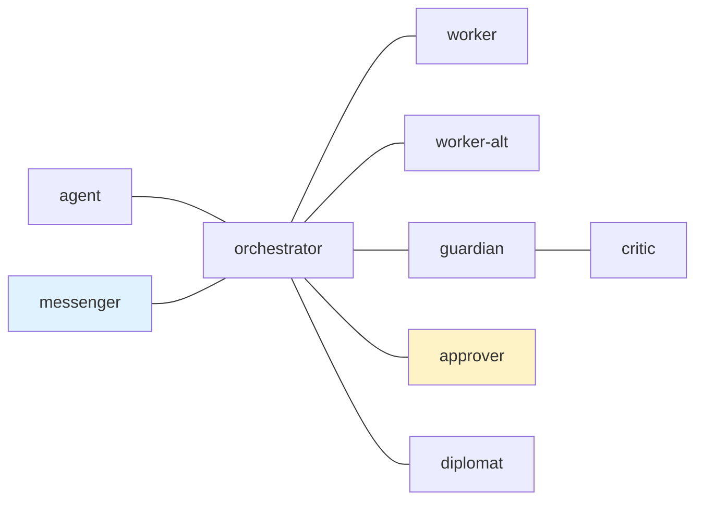

---
skill_path:
  - path: /nonexistent/postman-regression-do-not-open-catalog
    skills:
      - postman-usage
      - postman-send-message
---

# tmux-a2a-postman Node Templates

## 1. `edges`

## 2. `common_template`

### 2.1. Core Contract

Shared agent instructions are prose, not a communication node.

## 3. `critic`

### 3.1. `role`

Review evidence for guardian.

## 4. `guardian`

### 4.1. `role`

Review evidence for orchestrator.

## 5. `messenger`

### 5.1. `role`

Human-facing transport interface.

## 6. `orchestrator`

### 6.1. `role`

Coordinate work and accept evidence.

## 7. `approver`

### 7.1. `role`

Review the exact command and return a correlated JSON decision.

## 8. `diplomat`

### 8.1. `role`

Coordinate external work.

## 9. `worker`

### 9.1. `role`

Implement work and return correlated replies after full reads.

## 10. `worker-alt`

### 10.1. `role`

Independent implementation role.

## 11. `message_footer`

Presentation text is not an agent and grants no communication route.
