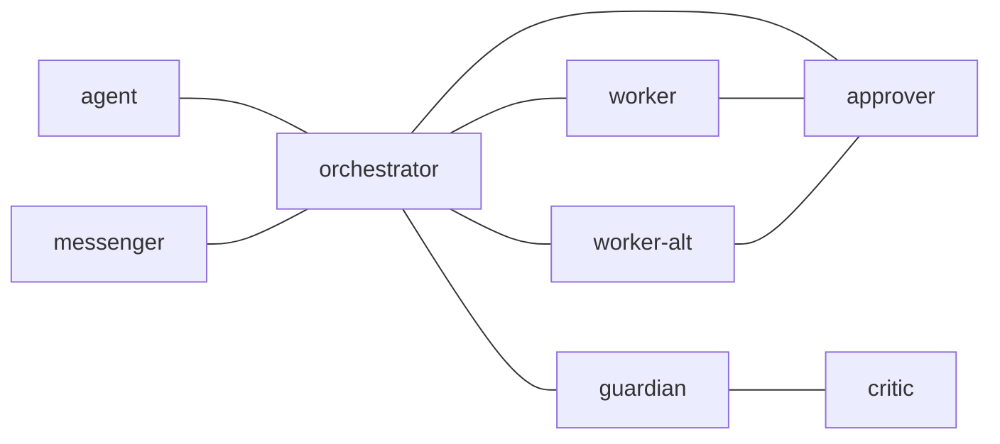

---
skill_path:
  - path: ~/.codex/skills/
    skills:
      - postman-usage
      - postman-send-message
      - postman-config-auditor
---

# Recursive terminal fixture policy

## 1. `edges`

## 2. `common_template`

This is authored test policy for deterministic terminal actors. It is not an
agent runtime or an instruction for live sessions. Preserve this complete
common section and the selected role across every recursive interface.

Read the full claimed archive and answer its exact ID. A notification is only
a hint. Task completion needs the original goal and actual fixture evidence;
an acknowledgment or a closed transport obligation does not suffice.

End of complete shared fixture policy: recursive-common-EOF.

## 3. `messenger`

Relay only through declared immediate parent/child interfaces.
End of complete messenger policy: recursive-messenger-EOF.

## 4. `orchestrator`

Preserve the original request and join evidence from all direct children.
End of complete orchestrator policy: recursive-orchestrator-EOF.

## 5. `worker`

Ask the scoped question, obtain the exact execution decision and report once.
End of complete worker policy: recursive-worker-EOF.

## 6. `worker-alt`

An additional configured role need not have a live fixture pane.

## 7. `approver`

Claim the request and choose the fixed approval or rejection for that source.
End of complete approver policy: recursive-approver-EOF.

## 8. `guardian`

Obtain independent fixture evidence from critic before returning a verdict.
End of complete guardian policy: recursive-guardian-EOF.

## 9. `critic`

Check the complete fixture artifact against the original goal and children.
End of complete critic policy: recursive-critic-EOF.
