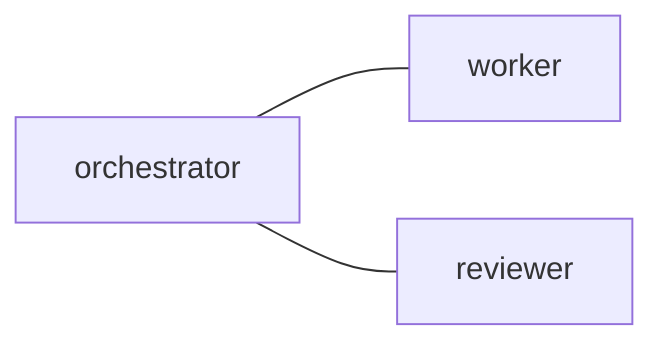

# postman.md format

## 1. Selection and local topology

Each invocation reads exactly one bounded regular Markdown file. Default:
`$XDG_CONFIG_HOME/tmux-a2a-postman/postman.md`, falling back to HOME/.config.
An absolute `--config` selects another file. Common/role text and configured
ordinary skill catalogs are included in each generated recipient archive.
Install skill files through the agent's ordinary skill mechanism; Postman
injects their discovery metadata and does not install or execute them. Routing
uses this file directly, without TOML, split-node overlays or daemon defaults.

````markdown
## `edges`



## `orchestrator`

Role instructions for the agent's own setup.

## `worker`

Worker instructions.

## `reviewer`

Review requests and return exact decisions.
````

The strict Mermaid subset accepts graph/flowchart direction, `---` edges,
simple labels/classes, `class` and `classDef`. Other edge operators and
malformed/duplicate sections fail. Node names are alphanumeric and hyphens,
start alphanumeric, and are at most 64 characters. Unique pane titles bind
roles. A class cannot invent an otherwise unknown node. Only one designated
reviewer/interface is allowed. An absent interface has no implicit default.

The existing `common_template` and `message_footer` H2 sections are reserved
alongside `edges`; numbered headings are accepted. They never become topology
nodes or grant routes/reviewer authority.
The send/execution adapters include their applicable presentation text in the
recipient Markdown. Read-only topology/status paths do not render instructions
or open catalogs. Other node headings still require valid, unique role names.

`command_approver_node` belongs in Mermaid; legacy frontmatter approval keys
are rejected. YAML `interface_node` can explicitly designate the local role.
Unknown frontmatter does not install hooks. The configured common contract,
selected recipient role, catalog and contact summaries are rendered into every
new archive, including replies, before the exact sender-authored Markdown.
Postman does not launch an agent or evaluate shell substitutions in policy.

`skill_path` retains ordinary catalog syntax: a path string, a list of paths,
or path entries with `skills: all` / a selected name list. Relative paths use
the config directory; `~/` uses HOME. Catalogs contain configured source paths
and sorted name/description bullets, not complete skill bodies. Missing roots
or selected metadata are rendering errors. PING-only catalog declarations do
not become ordinary-mail catalogs. Legacy notification cadences are not started.
Catalog reads and final archives are bounded; oversized policy fails explicitly.

`message_footer` preserves applicable ordinary guidance. Known contact/reply
placeholders use the actual recipient and current message ID. Typed execution
requests use the fixed approve-execution/decline-execution examples, instead
of a generic configured reply example. Instructions are saved with the mail;
recovery does not rewrite them using a later config revision. See the
[Markdown compatibility contract](../../../docs/design/recipient-markdown-parity.md).

## 2. Direct parent/child interfaces

Each session uses the same explicit tree declaration, but designates its own
local interface role. For example, the parent's frontmatter is:

```yaml
---
interface_node: orchestrator
workspace_tree:
  - session_name: parent
    interface_node: orchestrator
  - session_name: child
    parent_session_name: parent
    interface_node: worker
---
```

The child uses `interface_node: worker` with the same tree. Both interface
roles must be configured nodes. Send to `child:worker` from the parent
interface or `parent:orchestrator` from the child interface. Replies retain
the exact original session/role route. Grandchild shortcuts, siblings,
undeclared sessions, cycles, duplicate names and ambiguous live bindings fail.
Session names select a route, never replace native runtime verification.
The sessions need different workspace roots below HOME.

## 3. Recipient setup

Receiving roles, reply recipients and reviewers must be existing agent consoles
in their configured tmux panes. Notifications paste text and submit `C-m`
through the same transport for every agent type. No thread ID or notifier
registration is used. Preserve role pane titles in the agent configuration;
Codex uses `tui.terminal_title = []`. See
[README](../../../README.md#1-install-and-configure). Missing/blocked input
leaves mail durable and never grants command approval.

[Agent Runtime Feature Differences](../../../docs/agent-runtime-feature-differences.md)
is the long-term runtime comparison; do not duplicate it here.
