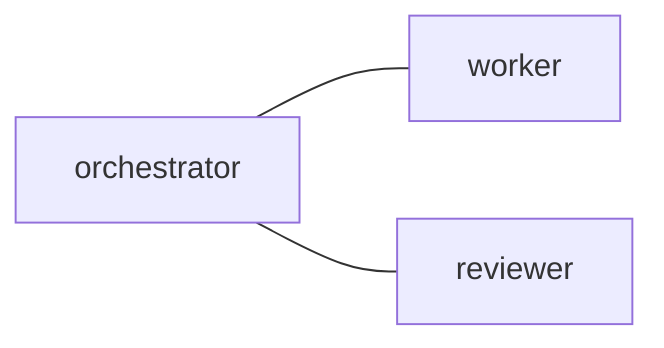

# postman.md format

## 1. Selection and local topology

Each invocation reads exactly one bounded regular Markdown file. Default:
`$XDG_CONFIG_HOME/tmux-a2a-postman/postman.md`, falling back to HOME/.config.
An absolute `--config` or `--postman-md` selects another file. No TOML,
split-node overlays, template injection, catalog loader or daemon defaults
are involved. Install skills through the agent's ordinary skill mechanism.

````markdown
## `edges`



## `orchestrator`

Role instructions for the agent's own setup.

## `worker`

Worker instructions.

## `reviewer`

Review requests and return exact decisions.
````

The strict Mermaid subset accepts graph/flowchart direction, `---` edges,
simple labels/classes, `class` and `classDef`. Other edge operators and
malformed/duplicate sections fail. Node names are alphanumeric and hyphens,
start alphanumeric, and are at most 64 characters. Unique pane titles bind
roles. A class cannot invent an otherwise unknown node. Only one designated
reviewer/interface is allowed. An absent interface has no implicit default.

`command_approver_node` belongs in Mermaid; legacy frontmatter approval keys
are rejected. YAML `interface_node` can explicitly designate the local role.
Unknown frontmatter does not install hooks or inject instructions. Role prose
is available to the agent's setup; Postman does not automatically render it
into mail or launch an agent.

## 2. Direct parent/child interfaces

Each session uses the same explicit tree declaration, but designates its own
local interface role. For example, the parent's frontmatter is:

```yaml
---
interface_node: orchestrator
workspace_tree:
  - session_name: parent
    interface_node: orchestrator
  - session_name: child
    parent_session_name: parent
    interface_node: worker
---
```

The child uses `interface_node: worker` with the same tree. Both interface
roles must be configured nodes. Send to `child:worker` from the parent
interface or `parent:orchestrator` from the child interface. Replies retain
the exact original session/role route. Grandchild shortcuts, siblings,
undeclared sessions, cycles, duplicate names and ambiguous live bindings fail.
Session names select a route, never replace native runtime verification.
The sessions need different workspace roots below HOME.

## 3. Recipient setup

Every receiving role needs the Bash/Readline integration emitted by
`notifier-script`, sourced in its own dedicated Bash pane. See
[README](../../../README.md#1-install-and-configure). A fresh shell must
register itself again. Missing/stale notification setup does not prevent
durable mail publication and does not grant command approval.

[Agent Runtime Feature Differences](../../../docs/agent-runtime-feature-differences.md)
is the long-term runtime comparison; do not duplicate it here.
