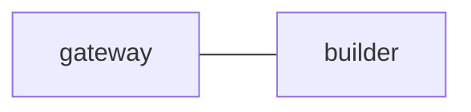

# Shared parent and child configuration

Both sessions use this exact file and their own gateway/builder panes. Place
the child workspace under the parent workspace below HOME. The nearest live
gateway interfaces can then address each other by native session name. No
session is created by reading this configuration.

## 1. `edges`

## 2. `common_template`

Read the complete POP archive through EOF. Keep each request's acceptance
criteria and exact reply correlation. Delegate only through your listed routes.
Reconcile child evidence before reporting completion upstream.

## 3. `gateway`

Coordinate this local team and its nearest live parent or child interface.

## 4. `builder`

Implement work for the local gateway and return concrete verification evidence.
